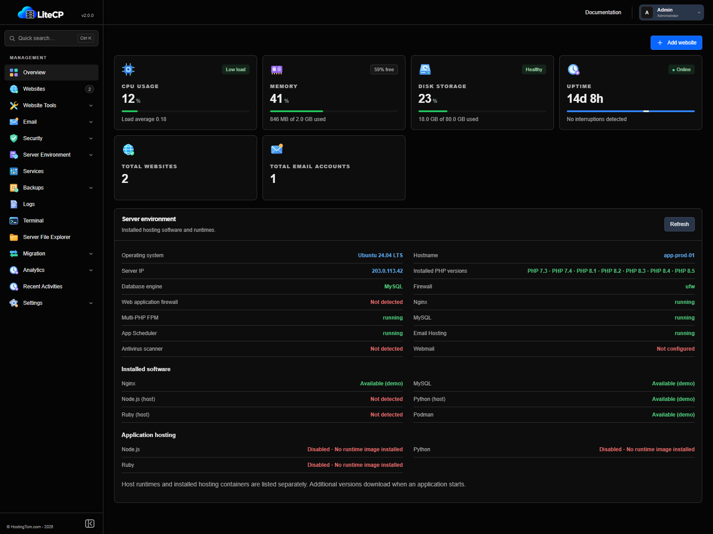

# LiteCP - By Hostingtom

LiteCP is a small, purpose-built control panel for self-hosted WHMCS, WordPress, and regular PHP/HTML websites. It supports Ubuntu and AlmaLinux and manages Nginx, parallel PHP-FPM runtimes, MySQL, files, cron, certificates, local and remote backups, firewall rules, databases, and email hosting.

The base panel is a single Go binary with an embedded vanilla HTML/CSS/JavaScript interface. It does not require a Node.js process, a cache/message-queue service, or a second database. Optional Rspamd spam filtering adds Redis-compatible cache storage and a local DNS resolver.

**LiteCP 2.0.0** brings a compact dark interface, grouped navigation, website tools, migration workflows, storage analytics and administrator security controls. The panel runs as a Go service with locally served browser assets. Optional hosting runtimes use containers and remain disabled until enabled.



*Current interface rendered locally with demonstration data. This screenshot is not a production server health report.*

## Included

File Manager's **Upload via URL** downloads a direct public HTTP/HTTPS file link
into the currently selected directory. It supports progress and cancellation,
uses the URL filename or a supplied filename, and refuses existing destinations.
Private/reserved addresses, embedded credentials, nonstandard ports and HTTPS
downgrades are blocked. The destination is confined to the website home and
downloaded code is not executed by the downloader. Two downloads may run at once,
with a 30-minute timeout. Authenticated third-party download pages are not supported.

Per-website PHP.ini Settings includes standard controls and an Advanced custom
directives field. Enter one supported `directive = value` per line; the editor
lists supported directives. Custom values persist with the website and are
applied to its PHP-FPM pool. Security boundaries, extension loading, and script
or filesystem paths remain protected. Duplicate/invalid directives are rejected
before changing the runtime. This edits managed overrides, not the global php.ini.

- Responsive, session-protected administrator dashboard
- CPU, memory, disk, load, uptime, and essential service health
- Safe start/restart actions for Nginx, every installed PHP-FPM runtime, MySQL, Postfix, Dovecot, and cron
- WHMCS, WordPress, or regular PHP/HTML virtual hosts with application-specific sensitive-file rules
- Per-website PHP selection, isolated PHP-FPM worker identities, and safe runtime switching
- Optional MySQL database and one-time generated credentials
- Website-home-confined file manager with multiple upload, visual HTML and source editing, character encoding selection, download, folders, rename, permissions, trash, ZIP/TAR/gzip/bzip2 archives, and validated extraction
- Let's Encrypt certificates through Certbot
- Five-minute WHMCS or WordPress cron management using each website's PHP version
- On-demand website and database backups with FTP, encrypted FTPS, or host-key-pinned SFTP destinations
- Database creation, password reset, and destructive deletion with local-only application users
- Postfix/Dovecot virtual mail domains, authenticated mailboxes, quotas, forwarding aliases, SMTP submission, and IMAPS
- UFW or firewalld management for scoped custom inbound rules, with essential LiteCP ports protected
- Allowlisted Nginx, PHP, database, mail, and cron log views
- Parallel PHP 7.3, 7.4, 8.1, 8.2, 8.3, 8.4 and 8.5 where packages are available
- ionCube Loader, OPcache, and low-idle-memory FPM defaults for every runtime
- HTTPS panel proxy on port `4321`
- Loopback-only database access and a minimal host firewall enabled during installation
- Fail2ban protection for repeated SSH authentication failures
- Website suspension/unsuspension, domain changes, pagination and storage sizes
- Multiple website cron jobs with manual test runs and application cron controls
- Website FTP accounts and phpMyAdmin access from database listings
- Separate Email pages for domains, mailboxes, aliases, webmail and delivery logs
- Outbound SMTP connectivity checks on ports 25 and 465
- Live cPanel, Plesk and LiteCP migration queues, cancellation, finished-job history and temporary-file cleanup
- Backup schedules, retention, remote destinations, manual website ZIP restore and system snapshots
- Live and historical CPU/memory/disk graphs, server directory analysis, free-space charts and LiteCP storage breakdown
- Interactive PTY terminal and a read-only Server File Explorer using the file manager interface
- Security Dashboard, administrator 2FA, firewall rules, Malware Scan, WAF and configurable SSH port
- SSH port 369 on fresh installations; existing installations preserve their SSH port
- Searchable documentation, quick search and collapsible sidebar groups
- User-run `update.bat` publication and server deployment with retained recovery binaries

LiteCP does not download WHMCS or WordPress itself. Upload the licensed WHMCS release or the official WordPress release to the provisioned document root.

## Supported systems

### Forgotten administrator password

From a root SSH terminal on the installed server, run:

```bash
sudo /usr/local/bin/litecp reset-admin-password
```

Enter and confirm the new password at the hidden prompts (12-1024 bytes).
The command briefly stops and restarts the running `litecp.service` to avoid
concurrent state writes and end existing panel sessions. Hosted websites stay
running. It preserves the administrator username, authenticator configuration,
and remaining recovery codes. If 2FA is enabled, login still requires an
authenticator code or an unused recovery code; this command does not bypass it.
The password is not accepted as a command argument or saved in plaintext.
For a non-default installation, set `LITECP_DATA_DIR` to the service's actual
data directory when invoking the command. Check that LiteCP restarts successfully.

### Change the panel HTTPS port

Open Security -> Panel Port. Allow the new TCP port in any provider firewall,
then select an unused port between 1024 and 65535. LiteCP adds host firewall
access, prepares SELinux HTTP port policy when enabled, validates Nginx, and
temporarily serves both ports. Open the new URL and confirm there within three
minutes to close the old listener. If not confirmed, the scheduled recovery
restores the original proxy configuration. Existing firewall rules and recovery
configuration copies are retained. Changing the port does not replace strong
passwords, 2FA or network access restrictions.

- Ubuntu 22.04 or 24.04 (x86_64 or aarch64)
- AlmaLinux 8, 9, or 10 (x86_64 or aarch64)
- A fresh VPS is strongly recommended
- At least 1 GB RAM; 2 GB or more is more comfortable for database, mail, and PHP traffic

Ubuntu 22.04 and 24.04 receive the requested PHP versions through the co-installable Ondřej Surý PHP PPA. AlmaLinux uses native parallel Remi Software Collection packages. Because Remi does not publish PHP 7.3 for AlmaLinux 10, LiteCP runs PHP 7.3 there in a resource-limited Podman container based on the final official PHP 7.3 FPM image. The FastCGI socket and database stay local to the VPS. PHP 7.3, 7.4, and 8.1 are end-of-life and should only be used temporarily for legacy application upgrades.

The AlmaLinux 10 PHP 7.3 compatibility image is intentionally isolated because forcing Enterprise Linux 8 or 9 RPMs onto AlmaLinux 10 would mix incompatible system libraries. It still contains end-of-life software and receives no upstream PHP security fixes; migrate legacy applications to a supported runtime as quickly as possible.

PHP selectors expose installed versions. Choose a runtime supported by the installed application and its extensions; selecting a runtime does not establish application compatibility. Common application profiles include:

- WHMCS 9.0: PHP 8.2 or 8.3.
- WHMCS 8.13 LTS: PHP 7.3, 7.4, 8.1, 8.2, or 8.3.
- WordPress: choose a currently supported PHP version compatible with your WordPress core, plugins and themes.
- Regular websites: any installed LiteCP PHP runtime; PHP 8.3 or newer is recommended for new applications.

Always check the current [WHMCS system requirements](https://docs.whmcs.com/8-13/installation-guide/system-requirements/) and [WordPress requirements](https://wordpress.org/about/requirements/) before upgrading an application or changing its PHP version.

> WHMCS officially validates Apache environments and notes that support for Nginx environments is limited. LiteCP uses Nginx deliberately for a smaller, focused runtime. See the same WHMCS requirements page before choosing this stack for a support-sensitive deployment.

## Install

Run as root on AlmaLinux or Ubuntu. Git is not required. This downloads the installer launcher, which downloads the source tarball, extracts it and starts installation:

```bash
cd /root && curl -fL https://raw.githubusercontent.com/itsmejeeban/LiteCP/main/scripts/bootstrap-install.sh -o litecp-latest.sh && bash litecp-latest.sh
```

If curl is missing, install it first with `dnf install -y curl` on AlmaLinux or `apt-get update && apt-get install -y curl` on Ubuntu. The launcher installs the remaining download tools, extracts into a new `/opt/litecp-install.*` folder and preserves existing source folders.

**Private repository:** the public command above requires public access to this repository. For a private repository, download the launcher with a hidden token prompt instead (the token is kept in memory):

```bash
cd /root && read -rsp 'GitHub token: ' token && printf '\n' && printf 'header = "Authorization: Bearer %s"\n' "$token" | curl --config - -fL https://raw.githubusercontent.com/itsmejeeban/LiteCP/main/scripts/bootstrap-install.sh -o litecp-latest.sh && unset token && bash litecp-latest.sh
```

The launcher will request a read token again to download a private source tarball. Alternatively, copy `install-litecp.sh`, `LiteCP-2.0.1-source.tar.gz` and its `.sha256` file together onto the server and run `bash install-litecp.sh`; that uses the supplied archive without a GitHub login.

To create the installation bundle from a local checkout, explicitly run `powershell -NoProfile -ExecutionPolicy Bypass -File scripts/package-source.ps1`. It creates a new, non-overwriting folder under `.staging/`, verifies the archive and opens the output folder. Private updater settings, Git history and audit screenshots are excluded.

On AlmaLinux, the installer uses Oracle's MySQL 8.4 LTS repository. Ubuntu 22.04 and 24.04 use their distribution MySQL 8.0 packages; the installer does not automatically replace those with Oracle MySQL 8.4. MySQL binds to localhost on both platforms, and installation reports the actual running version when available. LiteCP only selects MySQL's legacy `mysql_native_password` authentication for sites running PHP 7.3 or 7.4; newer runtimes use the current MySQL default. Root administration remains protected by local Unix-socket authentication. Use strong generated passwords and do not expose port 3306 publicly.

The installer generates a unique random administrator password, installs the required packages, builds LiteCP, and prints the panel URL:

```text
https://SERVER_IP:4321
```

For automated provisioning, optionally set the administrator username. Every fresh installation generates a new 48-character password using OpenSSL, ignoring any inherited `LITECP_ADMIN_PASSWORD`. The password is displayed once after installation completes; save it then. LiteCP does not save the plaintext password to a file or service environment; authentication stores only its salted password hash. Do not redirect installation output to a log if you want to avoid capturing the displayed password. Existing installations keep their administrator credentials.

```bash
sudo LITECP_ADMIN_USERNAME=admin \
  LITECP_MAIL_HOSTNAME=mail.example.com \
  bash scripts/install.sh
```

The included panel certificate is self-signed so the first browser visit will show a warning. Verify its fingerprint over SSH or replace it with a trusted certificate before regular administration. Allow TCP ports `80`, `443`, and `4321` in any provider-level firewall. Email hosting additionally uses `25`, `465`, `587`, and `993`.

## First website

1. Point the billing domain's A/AAAA records to the server.
2. In LiteCP, choose **Add website**, select WHMCS, WordPress, or Regular PHP/HTML Website, select a compatible installed PHP version, and enter a name such as `billing.example.com`.
3. Save the generated database credentials immediately; the password is shown once.
4. Upload the licensed WHMCS files or official WordPress files to `/home/litecp/billing.example.com/public_html` and remove the placeholder `index.html`.
5. Complete the application web installer using the generated database values.
6. Enable SSL after DNS resolves to the server.
7. Confirm the application sees its five-minute system cron. For WordPress, define `DISABLE_WP_CRON` as `true` after the system cron is enabled.
8. Apply the application's recommended post-install file permissions. For WHMCS, move the cron directory outside the public document root if your security policy requires it.

## File manager

Choose a managed website under **File manager**. LiteCP confines operations to the selected website home and refuses symbolic links. Uploads have no panel-imposed size or queue-count cap and run one file at a time; disk space and connection timeouts still apply. The manager supports text editing up to 64 MiB with the server's available iconv encodings, a visual HTML editor with formatting/source tabs, folders, copy/move/rename, permissions, download, trash/restore, and ZIP, TAR, gzip TAR and bzip2 TAR archives. Right-click text files for Edit; HTML files also offer HTML Editor. Images and binary files use View/Download.

Archive extraction rejects absolute paths, traversal, symbolic/hard links, special files, duplicate/conflicting members, more than 100,000 members, and archives expanding beyond 2 GiB. Existing files are moved to private recovery storage before replacement and restored if extraction fails. Creation enforces an 8 GiB archive-size limit while writing. TAR formats share the validated ZIP extraction transaction through bounded private conversion. Bzip2 compression requires `bzip2`; encoding conversion uses `iconv` (the installer installs these utilities). The visual editor disables document scripts and network resources, preserves untouched source, supports embedded image insertion and previews local raster images through authenticated file APIs. PHP-containing templates should use the source editor. Unsafe permissions and structural folders remain protected.

## Remote backups

Create an FTP, FTPS, or SFTP destination under **Backups**, then select it when running a website backup. The archive is always retained locally first. Destination passwords are encrypted with AES-GCM using `/var/lib/litecp/secret.key`, and neither the password nor encryption key is returned by the API.

SFTP destinations require the server's SHA256 host-key fingerprint. Obtain and verify that fingerprint through a trusted channel before saving the destination. Plain FTP does not encrypt credentials or backup contents; prefer SFTP or FTPS.

## Email hosting

LiteCP provides lightweight virtual mail hosting through Postfix and Dovecot. Add a mail domain, then create mailboxes and aliases. Clients use SMTP submission on `465` or `587` and IMAPS on `993` with the full mailbox address as the username.

Production delivery also requires work outside LiteCP:

- Set the mail hostname to a public FQDN and install a trusted certificate matching it.
- Point the mail hostname A/AAAA record and each hosted domain's MX record to the server.
- Publish the SPF, DKIM, and DMARC records shown by LiteCP. OpenDKIM signs outgoing messages after the optional mail feature is installed.
- Confirm that the VPS provider permits outbound TCP port 25 and configure reverse DNS with the provider.
- Test reputation and deliverability before sending billing messages.

The installer configures authenticated submission and rejects unauthenticated relaying. Mail-map changes are staged and rolled back if activation or service reload fails. Removing a mailbox or mail domain disables delivery/login but intentionally keeps its Maildir under `/var/vmail` for manual recovery.

For inbound/outbound spam filtering, run `sudo bash scripts/install-features.sh antispam`. This installs Rspamd, Redis (or AlmaLinux 10's compatible Valkey service) and a localhost-only Unbound resolver, connects Rspamd's milter to Postfix, and keeps the Rspamd controller private on loopback. Filtering and authentication improve delivery safety but cannot guarantee inbox placement.

## Firewall management

LiteCP manages custom allow rules through UFW on Ubuntu and firewalld on AlmaLinux. Rules can be limited to an IP address or CIDR range. Core SSH, web, panel, and mail ports cannot be duplicated or removed through the panel, reducing the chance of locking out the administrator.

## Developer run

Go 1.18 or newer is required.

```bash
export LITECP_DATA_DIR="$PWD/.data"
export LITECP_ADMIN_PASSWORD='a-long-development-password'
go run . init --username admin
unset LITECP_ADMIN_PASSWORD
go run .
```

Open `http://127.0.0.1:9090`. System mutations automatically use preview behavior on non-Linux systems. The frontend also has a localhost-only visual preview at `http://127.0.0.1:9090/?demo=1`.

Run the test suite with:

```bash
go test ./...
```

## Data and recovery

- Panel configuration: `/var/lib/litecp/config.json` (`0600`)
- Website homes: `/home/litecp/<domain>`; only `public_html/` is served publicly.
- Private website folders: `backups/manual/`, `backups/scheduled/`, `.trash/`, `tmp/`, `logs/`, `ssl/`, `etc/`, and `public_ftp/`. Application-specific folders such as `whmcsdata/` are not created automatically. File Manager Preferences can start at Home, Web Root, Public FTP Root, a selected website's Document Root, or the last opened folder.
- Existing installations keep their saved paths until explicitly migrated. Run `python3 scripts/migrate-site-storage.py` to preview; stop LiteCP, Nginx, cron and FTP before running with `--apply`. Use the updated service units and restart LiteCP afterwards to reconcile PHP pools. Migration copies data and retains original directories plus configuration recovery snapshots under `/var/lib/litecp/storage-migrations/`. Custom application configuration containing absolute paths may need updating. DNS, databases, domain names, and certificates remain unchanged.
- Nginx configs: `/etc/nginx/sites-available/litecp-*.conf` on Ubuntu or `/etc/nginx/conf.d/litecp-*.conf` on AlmaLinux
- Application cron files: `/etc/cron.d/litecp-*`
- Backups: `/var/backups/litecp/*.tar.gz`
- Encrypted-secret key: `/var/lib/litecp/secret.key` (`0600`)
- Mail maps and password hashes: `/etc/litecp/mail`
- Maildir data: `/var/vmail/<domain>/<mailbox>/Maildir`

Detaching a website removes its LiteCP-managed Nginx, isolated PHP pool, and cron configuration, but it intentionally keeps website files and the database. Local backups older than the configured retention period are pruned after a successful backup or settings update; off-server retention remains the remote provider's responsibility.

## Security model

- PBKDF2-HMAC-SHA256 password hashing with a unique salt and 600,000 iterations
- HTTP-only, SameSite=Strict, time-limited in-memory sessions; changing the password revokes all sessions
- Reverse-proxy-aware login throttling and constant-time credential comparison
- Same-origin checks for state-changing requests
- Fixed service-control actions; the administrator Terminal intentionally provides shell access with the panel service account's privileges
- Descriptor-relative file operations that refuse symlinks, plus ZIP-member, archive-size, upload-size, and permission validation
- AES-256-GCM encryption for stored remote-backup credentials
- SFTP SHA256 host-key pinning and TLS-required FTPS support
- Local-socket-only database administration with validated SQL identifiers
- Authenticated SMTP submission with unauthenticated relay rejection
- Fail2ban protection for SSH, Postfix/SASL and Dovecot, plus automatic operating-system security updates
- Atomic durable state/configuration writes, rollback on failed mutations, and strict domain validation
- Per-website numeric PHP identities, sockets, and document-root restrictions
- Panel process isolated with systemd filesystem and kernel protections
- No application database password persistence after provisioning; mailbox passwords are one-way hashed

LiteCP runs as root because it must update Nginx, cron, certificates, ownership, and system services. Keep port `4321` private to administrator IPs when possible, maintain normal operating-system updates, and copy backups to separate storage.

## Project layout

```text
.
├── main.go               HTTP server, authentication, and core API
├── main_extra.go         file, database, backup, firewall, and mail APIs
├── store*.go             atomic JSON configuration store
├── system.go             core allowlisted Linux operations
├── files.go              confined file manager and ZIP handling
├── infrastructure.go     secrets, remote backup, database, and firewall operations
├── mail.go               Postfix/Dovecot maps and mailbox operations
├── web/                  embedded control-panel UI
├── deploy/               systemd and PHP/FPM profiles
└── scripts/install.sh    Ubuntu/AlmaLinux installer
```

## License

Add the license appropriate for your distribution before publishing the project.

### ClamAV during installation

New installations include ClamAV, initial malware signatures and a twice-daily signature update timer. Scans run on demand or using the panel scan schedule; files are not automatically deleted. Installation reports an error if the initial signature download or update timer fails. For a deliberately minimal installation, set `LITECP_INSTALL_ANTIVIRUS=0`. Existing servers can install the same component from the source directory with `sudo bash scripts/install-features.sh antivirus`.

### System Update

The System Update page compares installed OS packages with upgrade candidates from the server's configured APT/DNF repositories. Check updates, update selected packages or all eligible packages, or enable a daily/weekly timer (disabled by default). Updates run in a background system service and do not request a reboot. Package maintainer scripts can restart services; take a recovery backup before updating. Existing OS security-update timers remain independent.

Source-built WAF installations hold Nginx packages back in this updater so an ABI change does not strand the connector. LiteCP releases, Roundcube/phpMyAdmin, ionCube and hosting container images remain managed by their dedicated update tools. They are explicitly listed as separate components rather than claiming repository coverage. Diagnostics: `/var/lib/litecp/system-updates/operations.log` (private); schedule service: `litecp-system-update.timer`. Repository access and Linux package-manager integration require live validation before production use.
